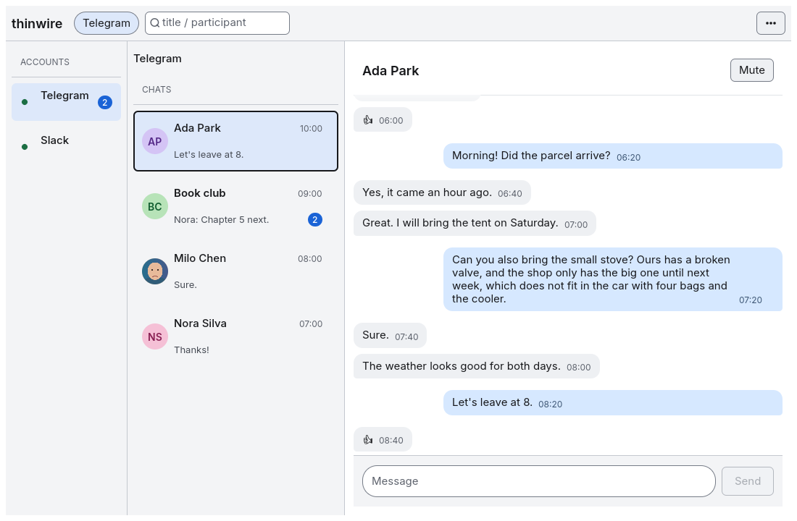

# thinwire

Thin, low-resource desktop messenger shell in **Rust + egui**.
One UI for many protocols. Targets **Windows, macOS, and Linux**.
The UI thread must never block; protocol I/O runs async off the main thread.

<picture>
  <source media="(prefers-color-scheme: dark)" srcset="crates/thinwire/tests/snapshots/several_protocols-dark-1100x720.png">
  
</picture>

The image is the UI snapshot test output, so it changes with every UI change.

## Status

Inbox shell (account switcher + conversations on the left, thread in the center) with protocol adapters behind a tokio channel. The UI only polls events; workers must not call egui APIs.

v1 protocols are Telegram, WhatsApp (experimental), Discord (bot/OAuth inbox only), Slack OAuth, and Signal (experimental). Release builds ship Telegram, the Discord bot inbox, WhatsApp, and Signal (ADR `0013-ship-all-protocols-agpl-helpers`). WhatsApp and Signal each run in a separate AGPL-3.0-only program: `thinwire-whatsapp-helper` and `thinwire-signal-helper`. The Signal client is `crates/thinwire-signal` (AGPL-3.0-only). It links Presage and libsignal. Its cargo feature is `signal-local`. It stays off by default.

First-run and Add account offer Telegram (TDLib) only. Official binaries inject `api_id` / `api_hash` at compile time, so end users sign in with phone → code → optional 2FA. Each login step puts the cursor in its field. Enter submits and Esc cancels. A refused step shows a specific error, for example a wrong code or an expired code. The code step says where Telegram sent the code (app, SMS, or call). If Telegram sends a word or a phrase by SMS, the code field accepts letters. On every screen, Enter runs the main button. "Send a new code" asks Telegram for a new code. "Change number" goes back to the phone step. The primary login UI never opens on paste-api fields. Dev builds without inject show credentials missing (rebuild with `TELEGRAM_API_ID`, or Advanced keychain override) and do not send every user to my.telegram.org. Slack, WhatsApp, and Discord protocol stubs remain. Their inbox work runs in parallel with Telegram (#34, #35, #36). Their auth UI appears only when its cargo feature is on. Default builds show only Telegram in the filter tabs and the account switcher. Slack, WhatsApp, or Discord chrome appears only when its cargo feature is on. Discord user-account / self-bot fields do not exist. thinwire is not a personal Discord client. The default CI jobs keep `telegram-tdlib`, `discord-bot`, `slack-oauth`, and `whatsapp-web` off so they do not link or download TDLib, do not compile the Discord bot inbox, do not compile `slack-morphism`, and do not compile the WhatsApp linked-device client. One CI job, `release-features`, turns on every feature that a release ships. The unauthorized Telegram banner drops only after TDLib Ready. With a saved session, the next launch shows "Connecting to Telegram…" and opens the inbox without the login screen. If Telegram ended the session, the app shows the phone step with a notice. If the saved data folder cannot open, the app moves it aside. The app keeps that folder. The phone step names that folder once.  After Ready, the inbox loads the main chat list, opens a chat for recent messages, and sends text on the worker thread. The chat list and the thread scroll. The thread opens at the newest message and follows new messages only when the view is at the bottom. The inbox shows "Loading chats…" and "Loading messages…" until the rows arrive, and it shows a message for an empty chat or a search with no match. In compose, Enter sends and Shift+Enter adds a line. Each chat keeps its own draft. A failed send shows "Not sent" and keeps the text. Retry asks TDLib to resend that message (`resendMessages`). The thread shows messages as bubbles by side, with the local time on each message and day breaks (Today, Yesterday, then the date). Group chats name the sender at the start of each run. Private chats and channels do not show sender names. The chat list shows the time of the last message. When you close the window, the app closes TDLib first and then exits. The window closes after 5 seconds at most. Cancel during login also closes TDLib. SIGTERM and SIGINT (Ctrl+C) close the window through the same step. A second signal exits at once with code 130. Enable `--features telegram-tdlib` locally after a TDLib install for the live `tdlib-rs` client. The Discord bot/OAuth guild inbox is a separate spike: `--features discord-bot` (twilight HTTP, ADR `0009-discord-bot-inbox-spike`). With a bot token, it lists the guild channels the bot can read, loads recent messages, and sends as the bot. The inbox shows when the feature is compiled. It does not wait for Telegram (`adfbb8c`, PR #40). Slack is a workspace-app OAuth v2 and Socket Mode scaffold (`slack-oauth`, ADR `0008-slack-oauth-workspace-spike`) with no Slack auth screen. Publisher `SLACK_CLIENT_ID`, `SLACK_CLIENT_SECRET`, and `SLACK_APP_TOKEN` stay out of git and public CI. Appearance defaults to the OS light/dark theme (System).

The WhatsApp linked-device client is cargo feature `whatsapp-web` (`whatsapp-rust` from oxidezap, pinned to a git revision). It is experimental and not the default UI. Default builds and the default CI jobs leave the feature off, so there is no WhatsApp pairing screen and the WhatsApp account is not marked ready. Release builds turn the feature on. This client is not a supported messenger. The default build uses an MIT stub in `thinwire-protocol`.

The WhatsApp client is not in the app. It runs in a separate program, `thinwire-whatsapp-helper`, from `crates/thinwire-whatsapp` (AGPL-3.0-only, #77, ADR `0013`). The MIT app starts the helper as a child process and talks to it over a pipe (`crates/thinwire-ipc`). The app does not link the helper.

- A full-screen ban acknowledgement comes before any QR or phone-pair UI. The helper starts only after you accept it.
- The app looks for the helper next to its own binary (`Contents/MacOS` in `Thinwire.app`). If no helper is there, the app uses the path from `whatsapp_helper = "<path>"` in `settings.toml`.
- If the helper is missing, the WhatsApp entry stays, but it is disabled. The account row shows "WhatsApp helper missing. Reinstall thinwire."
- The window never waits for the helper. If the helper does not answer in 1.5 seconds, the account row shows "Helper is busy…".
- If the helper stops, the app starts it again after 1, 2, 4, and 8 seconds. The account then links again from its session store. Each send with no answer shows "Not sent".
- After 5 failures in a row, the account row shows "Helper stopped." and Restart. Restart starts the helper again.
- Only one helper process uses the session store. A second helper finds the lock and does not start.
- The device store stays in the platform app-data directory, not in git.
- The helper encrypts `device.sqlite`. It stores a random key in the OS keychain. The service is `thinwire`. The account is `whatsapp.store_key`. The key is not in a file, a log line, a command line, or an environment variable.
- This encryption does not stop a program that runs as the same user and can read the keychain.
- If the keychain cannot save the key, the helper does not link WhatsApp. The account row shows the reason. The helper does not write a store.
- If the keychain read fails on a saved account, the account row stays linked. It shows "Can't read the session key from Keychain. Allow access, then retry." and Retry. Retry reads the key again. The helper does not move the store and does not start a new link. A first link that cannot read the key shows "WhatsApp did not link." A saved account does not.
- If the key is missing or wrong, the helper keeps the store. It moves the store files into a folder beside the session folder. The session folder and `helper.lock` stay, so a second helper cannot start. The account row leaves the linked state. It shows "Can't open the saved WhatsApp session. Your old data is kept. Link again" and Link. Link opens the ban gate. It does not delete the old files.
- If the helper cannot move those files, they stay in the session folder. Nothing is deleted. The account row stays linked. It shows "The saved WhatsApp session could not be moved aside. It was left in place. Nothing was deleted." and Retry. Retry tries the move again. It does not start a new link and it does not delete anything.

The Signal client is cargo feature `signal-local` (`presage`, pinned to a git revision). It is experimental and not the default UI. Default builds and the default CI jobs leave the feature off. Release builds turn it on. The client runs in a second program, `thinwire-signal-helper`, from `crates/thinwire-signal` (AGPL-3.0-only, ADR `0013`, #248). The app does not link it. The rules of the WhatsApp helper apply to the Signal helper too:

- A full-screen notice comes before any provisioning QR code. The helper starts only after you accept it.
- The app looks for the helper next to its own binary. If no helper is there, the app uses the path from `signal_helper = "<path>"` in `settings.toml`.
- If the helper is missing, the Signal entry stays, but it is disabled. The account row shows "Signal helper missing. Reinstall thinwire."
- Each helper is its own process. If the Signal helper stops, the WhatsApp helper keeps running, and the reverse.
- After 5 failures in a row, the Signal account row shows "Helper stopped." and Restart.
- Signal links with a QR code only. No phone number goes to the Signal helper.
- The session store stays in `thinwire/signal/` in the platform app-data directory. A device that an older local build linked stays linked.
- The helper encrypts every Signal store. That is the live `session.sqlite`, a pending link file, and every `session.sqlite` under `retained/`.
- One key opens all of those files. The helper stores it in the OS keychain. The service is `thinwire`. The account is `signal.store_key`. A retained store is the live store after a rename, so it uses the same key. The Signal key is not the WhatsApp key.
- This encryption does not stop a program that runs as the same user and can read the keychain.
- The helper copies an old plaintext store into a new encrypted file. It checks the row counts. A blocked checkpoint keeps the plaintext store. It then removes the plaintext file. A failed check keeps the plaintext store.
- A link of a different account still moves the old store into `retained/`. The helper does not delete that store.
- If the keychain cannot save the key, the helper does not link Signal. The account row shows the reason. The helper does not write a store.
- If the keychain read fails on a saved Signal account, the row stays linked and shows the same Keychain sentence and Retry as WhatsApp. A first link shows "Signal did not link." The helper does not move the store.
- If the key is missing or wrong, the helper moves the store files into a folder beside the session folder and leaves `helper.lock` in place. The account row leaves the linked state. It shows "Can't open the saved Signal session. Your old data is kept. Link again" and Link. Link starts the same QR flow as a removed device. It does not delete the old files.
- If the helper cannot move those files, they stay in the session folder. Nothing is deleted. The account row stays linked. It shows "The saved Signal session could not be moved aside. It was left in place. Nothing was deleted." and Retry. Retry tries the move again. It does not start a new link and it does not delete anything.
- If a file under `retained/` is corrupt or does not open, the helper leaves that file in place. The live session stays. The log line has no account id and no path.

## Protocol support (honest)

| Protocol | Path | Support language |
| --- | --- | --- |
| Telegram | Official TDLib via Rust bindings (`tdlib-rs`) | Supported goal |
| Slack | Official Slack OAuth v2 / Socket Mode (workspace app, `slack-morphism`, feature `slack-oauth`) | Supported goal |
| WhatsApp | Unofficial Web / linked-device (`whatsapp-rust` in the `thinwire-whatsapp-helper` process, feature `whatsapp-web`, off by default) | **Experimental** |
| Signal | Unofficial linked secondary device (`presage` in the `thinwire-signal-helper` process, feature `signal-local`, off by default) | **Experimental** |
| Discord | Bot/OAuth guild inbox spike (`discord-bot`, twilight). Not a personal Discord client. No user-account, self-bot, or personal DM path | Constrained / experimental |

## Risk notice (required)

1. WhatsApp (unofficial Web/linked-device) and Discord (user-account / self-bot) can get the user’s personal account banned or terminated. License-clean crates do not grant Meta or Discord permission.
2. Do not call WhatsApp or Discord “reliable.” Unofficial WhatsApp clients and Discord user-account / self-bot paths can break or violate ToS.
3. “Fast and reliable” applies only to Telegram via official TDLib and Slack via official OAuth (workspace app, not a personal desktop clone). WhatsApp is experimental and Discord is bot/OAuth inbox only. The app must not market them as production messaging.

Risk for each protocol:

- Telegram: official TDLib. The Telegram Terms of Service apply to your account.
- WhatsApp: unofficial linked-device client. WhatsApp can ban or restrict your account. The app shows a full-screen ban gate before any QR code or pair code.
- Discord: bot/OAuth guild inbox only. A user-account or self-bot client can get an account terminated, so thinwire has none.
- Slack: official OAuth for a workspace app. The workspace admin controls the install. The OS artifacts do not have Slack yet.
- Signal: no supported third-party API, expect breakage. thinwire links as a secondary device with an unofficial client. The app shows a full-screen notice with this text before any provisioning QR code.

## License

MIT. Keep third-party notices (including Boost for TDLib if bundled). The binary embeds the Inter font (SIL OFL 1.1). See `crates/thinwire/assets/fonts/`. Release archives ship its license as `THIRD_PARTY_NOTICES/Inter-OFL.txt`. Chat photos use `egui_extras` and `image` (jpeg, png, and webp). The same folder ships the MIT and Apache-2.0 texts of `egui_extras`, `image`, `png`, and `image-webp`, and the MIT, Apache-2.0, and Zlib texts of `zune-jpeg` and `zune-core`. A second launch on Windows uses `interprocess` (0BSD OR Apache-2.0) and `widestring` (MIT OR Apache-2.0). The same folder ships those texts. Linux and macOS use the Rust standard library for that socket. Links open in the default browser through `webbrowser` (MIT OR Apache-2.0). The same folder ships its MIT and Apache-2.0 texts.

`crates/thinwire-whatsapp` and `crates/thinwire-signal` are AGPL-3.0-only. They build the programs `thinwire-whatsapp-helper` and `thinwire-signal-helper`. No MIT crate depends on those folders. The app talks to each helper over a pipe (ADR `0013`). `scripts/check-agpl-deps.sh` and `scripts/check-release-tree.sh` keep AGPL code out of the app. This is an engineering decision. It is not legal advice.

Release archives ship the helpers with these files in `THIRD_PARTY_NOTICES`:

- `thinwire-whatsapp-helper-AGPL-3.0.txt` and `thinwire-signal-helper-AGPL-3.0.txt`: the license of each helper.
- `thinwire-whatsapp-helper-SOURCE.md` and `thinwire-signal-helper-SOURCE.md`: where the source of each helper is.
- The licenses of `whatsapp-rust` (MIT), `tdlib-rs` (MIT OR Apache-2.0), and `twilight` (ISC).

The source of both helpers and of every dependency is `thinwire-helpers-<commit>-source.tar.gz`. It includes `whatsapp-rust`, `wacore-libsignal`, presage, and libsignal. The same workflow run uploads it as artifact `thinwire-helpers-source`. `scripts/helper-source.sh` builds it from the commit and `cargo vendor`.

## Build

`rust-toolchain.toml` pins Rust 1.98.1 for rustup. The workspace MSRV (`rust-version`) is 1.88. A Nix flake supplies the same tools as CI. The Nix shell uses the nixpkgs `rustc`, not the rustup pin. `.envrc` stays local.

```bash
cargo build --workspace
cargo test --workspace
cargo clippy --workspace --all-targets -- -D warnings
cargo run -p thinwire
```

With Nix:

```bash
nix develop --command scripts/lint.sh
nix develop --command scripts/test.sh
```

UI snapshots (Linux, lavapipe). The default `cargo test` does not run them. CI job `ui-snapshots` does. Rewrite the images in `crates/thinwire/tests/snapshots/` with:

```bash
nix develop --command scripts/update-snapshots.sh
```

Live Telegram run in the Nix shell (Linux):

```bash
nix develop --command cargo run -p thinwire --features telegram-tdlib
```

The Linux dev shell adds the items that a live run needs:

- `llvmPackages.libcxx`. The static TDLib links and loads `libc++` and `libc++abi`. You do not need the distro `libc++-dev` packages in this shell.
- nixpkgs `mesa` for OpenGL. The shell sets `LD_LIBRARY_PATH`, `__EGL_VENDOR_LIBRARY_DIRS`, and `LIBGL_DRIVERS_PATH` to that mesa. On non-NixOS Linux, the Nix `libglvnd` does not find the host GL drivers without these variables.
- nixpkgs `vulkan-loader` and mesa lavapipe (`VK_DRIVER_FILES`) for the UI snapshot tests.

GPU notes:

- AMD and Intel: the nixpkgs mesa works on non-NixOS Linux.
- NVIDIA: mesa does not drive the NVIDIA GPU. Start the app through [nixGL](https://github.com/nix-community/nixGL). Inside the shell, run `nix run --impure github:nix-community/nixGL#nixGLNvidia -- cargo run -p thinwire --features telegram-tdlib`.
- The binary loads `libc++` from the Nix store through the shell `LD_LIBRARY_PATH`. Outside the shell, the binary can fail to start.

CI feature matrix: `cargo test --workspace` and `cargo clippy --workspace --all-targets -- -D warnings` run **without** `telegram-tdlib`, **without** `discord-bot`, **without** `slack-oauth`, **without** `whatsapp-web`, and **without** `signal-local`. That is the merge-critical default.

One more job, `release-features`, runs `scripts/test-release-features.sh` (ADR `0013`):

- It runs clippy and the tests of the app with `telegram-tdlib`, `slack-oauth`, `discord-bot`, `whatsapp-web`, and `signal-local` on. It sets no publisher secret.
- It runs clippy and the tests of the WhatsApp helper and of the Signal helper, each with its client. The tests start the real helper process. No test starts a pairing.
- It runs `cargo deny check advisories` on the dependency graph of each helper (config `deny.toml`).
- It stages both helpers next to an app binary with `scripts/stage-helper.sh`, and it runs the two AGPL guard scripts.

Job `helper-os` does the helper steps on Windows and macOS. It runs only when the helper code or the dependencies change.

The Signal client needs the protobuf compiler `protoc` when it builds. The nix dev shell has it. The CI jobs that do not use nix run `scripts/install-protoc.sh`, which downloads one pinned release and checks its SHA-256.

Live TDLib (local install; `tdlib-rs` downloads a prebuilt `tdjson`; never commit `api_id` / `api_hash` / session strings):

```bash
# Official / local inject — export in the private release environment, not in git.
TELEGRAM_API_ID= TELEGRAM_API_HASH= cargo build -p thinwire --features telegram-tdlib
```

Official main OS zips read `TELEGRAM_API_ID` and `TELEGRAM_API_HASH` from GitHub repository secrets. Local builds export the same names before cargo (empty placeholders above). Public CI never sets them. A keychain override in Advanced wins over the publisher pair when both exist. Linux live builds outside Nix need `libc++-dev` and `libc++abi-dev` because the feature statically links the prebuilt TDLib. The Nix dev shell supplies them (see Build).

TDLib data folder:

- `THINWIRE_TDLIB_DIR` wins when it is set.
- With a keychain that saves, the folder is `$XDG_DATA_HOME/thinwire/tdlib`, then `~/.local/share/thinwire/tdlib`. On Unix, the app sets it to mode `0700`.
- On Linux with keyutils only (no Secret Service), the folder is `thinwire/tdlib-keyutils` under the same base. A keyutils key is lost at a restart, so this folder is separate from the Secret Service folder. If you used keyutils only before this change, sign in once.
- If Secret Service is present but fails (for example a locked wallet), the app does not use keyutils. It shows "The keychain could not be read" and Try again.
- With a memory-only keychain, the app uses a throwaway folder. The folder is under `$XDG_RUNTIME_DIR` when that is private, else under the temp folder. The name has 8 random bytes and the mode is `0700`. The app refuses a folder or symlink that is already at that path. A clean shutdown removes the folder.
- If TDLib reports "Wrong database encryption key", the app moves the old folder aside to `tdlib.stale-<unix seconds>`. It never deletes that folder. The phone step names that folder once. A lock error ("already in use") does not move the folder.
- Never commit a TDLib folder.

Discord bot inbox (local only; twilight HTTP client; no gateway yet, so new messages show when you open the channel again; never commit a bot token):

```bash
cargo build -p thinwire --features discord-bot
```

The bot token lives in the OS keychain account `discord.bot_token` (service `thinwire`). A `Bearer` value is refused until its application provenance and `bot` scope are verified. Public CI must not set a token. There is no Discord login form.

Slack workspace-app spike (types only; this command does not call Slack). Register redirect `http://127.0.0.1:8976/slack/oauth/callback` on the Slack app when a later beat binds the loopback listener. Public CI must not set the env vars:

```bash
SLACK_CLIENT_ID= SLACK_CLIENT_SECRET= SLACK_APP_TOKEN= cargo check -p thinwire --features slack-oauth
```

Local run of the experimental WhatsApp client (not the default UI). Build the helper with its client, then run the app with the WhatsApp screens. Cargo puts both binaries in `target/debug`, so the app finds the helper next to its own binary:

```bash
cargo build -p thinwire-whatsapp --features whatsapp-web --bin thinwire-whatsapp-helper
cargo run -p thinwire --features whatsapp-web
```

The helper writes its log to stderr. The app writes those lines at level `debug` with the prefix `helper:`. The helper writes only the log lines of thinwire code. `RUST_LOG` sets their level. It cannot turn on the log of `whatsapp-rust`, because that library logs the pair code.

A plain `cargo build` also builds the helper, but with no WhatsApp client. That helper refuses to run, and the account row shows "Helper stopped." with the reason. Build it with `--features whatsapp-web`, as above.

Local run of the experimental Signal client (not the default UI). The build of the helper needs `protoc` on the PATH (the nix dev shell has it):

```bash
cargo build -p thinwire-signal --features signal-local --bin thinwire-signal-helper
cargo run -p thinwire --features signal-local
```

A Signal helper with no client (a plain `cargo build`) refuses to run in the same way. Build it with `--features signal-local`.

The Signal helper also writes only the log lines of thinwire code. `RUST_LOG` cannot turn on the log of presage or libsignal, because presage logs the provisioning URL.

Telegram `api_id`, `api_hash`, and session material go to the OS secret store (`keyring`):

| Platform | Store |
| --- | --- |
| macOS | Keychain |
| Windows | Credential Manager |
| Linux | D-Bus Secret Service first (KDE Wallet or GNOME Keyring, pure Rust `zbus`, no `libdbus` at build time). Then kernel keyutils. Then memory. The app probes each store with one read before it uses it. |
| Linux headless / CI | The same order. Keyutils keeps secrets only until the computer restarts. Memory keeps them only for this process. Nothing goes to a file. |

Set `THINWIRE_KEYRING=memory` to skip the OS keychain (CI and local headless). The UI thread only reads/writes an in-memory map; OS keychain attach and flush run on a tokio `spawn_blocking` worker. Never put secrets in the repo, `.env` committed files, logs, or CI artifacts. Tests use the memory backend and stay green without a desktop keychain or TDLib. Signal and WhatsApp session keys need a keychain that keeps values across a restart. A memory keychain and Linux keyutils do not keep those keys. Those helpers do not link, and they do not write a store. The status strip tells you how long the sign-in lasts:

- Memory only: "Sign-in is not saved on this device: keychain unavailable." The next launch cannot resume the session.
- Keyutils: "Sign-in is kept until you restart the computer."
- Secret Service, macOS Keychain, and Windows Credential Manager: no notice.

While the keychain opens, the app shows "Opening the keychain…". After 1 second it shows "Waiting for the keychain. Unlock it to continue." A locked wallet can put its unlock prompt behind the window.

Theme preference is `System` (follow the OS, including live `ThemeChanged` updates), `Light`, or `Dark`. A missing `settings.toml` means System. The file lives under the platform config dir (`~/.config/thinwire/settings.toml` on Linux). It stores the theme mode and the two notification switches.

Desktop notifications (#32) show a new message when you do not look at its chat. They are on by default. The "⋯" menu has two switches: "Show notifications" and "Hide message text".

- The core rules are the same for each protocol. A muted chat, your own message (also from another device), an open chat in a focused window, and a message older than 5 minutes do not notify.
- A protocol notifies only for a message that it marks as new (live). A history page never notifies. A protocol can also report whether you muted a chat. The table says what each protocol does today:

| Protocol | Notifies for new messages | Reads your mute |
| --- | --- | --- |
| Telegram | Yes | Yes (the chat setting, or the private, group, or channel default) |
| WhatsApp (`whatsapp-web`, helper process) | Yes | Yes (the phone's chat mute, also a mute with an end time) |
| Slack (`slack-oauth`) | Yes (Socket Mode messages) | No: the workspace bot cannot see your personal mute |
| Discord (`discord-bot`) | No: the bot inbox has no gateway yet, so no message arrives live | No: the bot cannot see your personal mute |
| Signal (`signal-local`, helper process) | Yes (the receive stream) | No: the Signal library does not expose chat mute |

- You can also mute a chat in thinwire, in every protocol (#153). Use the "Mute" button in the chat header, or right-click the chat in the inbox. A thinwire mute works like a protocol mute: the chat does not notify and its unread count is not in the window title. The inbox row shows "muted".
  - A protocol mute wins. A chat that the protocol mutes shows "Muted in Telegram" (or its protocol), and only that protocol can unmute it.
  - The thinwire mute stays on this computer. It does not change the mute on your phone or in other apps.
  - The muted chats are stored in `muted_chats` in the platform data dir (`~/.local/share/thinwire/muted_chats` on Linux), with file mode 0600. Chat ids can hold personal data (a WhatsApp id holds a phone number), so the file is not next to `settings.toml`.
  - When the mutes go: the Telegram mutes go when the Telegram session ends for good (a logout from another device, or Telegram ended the session), also when it ended while the app was closed and the app then asks for the phone number again. The next account on this computer does not get them. The WhatsApp mutes go when the phone logs this device out (Linked devices → Log out). A reconnect, a ban, an app restart, or a stopped client keeps every mute. Slack, Discord, and Signal have no account removal in the app yet, so their mutes stay in the file until you unmute the chats or delete the file.
  - If the app cannot read `muted_chats` (for example, no read permission), it does not change the file. New mutes then work until the app closes.
- A chat whose mute the app cannot read notifies, unless you mute it in thinwire. Turn off "Show notifications" if that is too much.
- The window title shows the unread count of chats that are not muted, for example "thinwire (3)".
- Privacy: a notification sends the chat title, the sender in a group, and up to 120 characters of the message to the OS notification service. "Hide message text" sends "New message" only, with no sender. thinwire never writes message text to its log.
- What each OS does today:

| | Linux (freedesktop, D-Bus) | Windows (toasts) | macOS 12 or later (`Thinwire.app`) |
| --- | --- | --- | --- |
| Show a notification | Yes | Yes | Yes, after you allow it |
| One notification for each chat: a new message replaces it, with the count | Yes | Yes | Yes |
| "Hide message text" also changes a notification that already shows | Yes. With more than 16 notifications on screen, one with no click waiter closes instead | Yes, with no popup and no sound | Yes, with no banner and no sound |
| Remove it when you open the chat, read it on another device (where the protocol reports it), the chat leaves the list, you turn notifications off, or the app closes | Yes | Yes | Yes |
| A click opens the chat | Yes. On X11 the click also raises the window. On Wayland the app cannot raise its window yet (winit 0.30): the taskbar entry asks for attention instead | Yes, while the app runs. Windows can refuse to raise the window: the taskbar entry then flashes | Yes, while the app runs |

- Linux, with more than 16 notifications on screen: a new one has no click waiter. A later message in that chat shows a second notification instead of a replace, and a click on it does not open the chat. A dismiss still closes it.
- Windows: each start writes one registry key for the app, `HKCU\Software\Classes\AppUserModelId\dev.jaysonsantos.thinwire`, with the value `DisplayName` = `Thinwire`. Windows needs this key to show the app name on a toast and to send a click back to the app. It needs no admin, and the app writes no other registry key. To remove it: `reg delete "HKCU\Software\Classes\AppUserModelId\dev.jaysonsantos.thinwire" /f`.
- Windows: a start removes the toasts of an earlier run that did not close cleanly. No chat id goes to Windows: each toast has a short hash of its chat as its tag.
- macOS: the first start of `Thinwire.app` asks for permission to show notifications. If you say no, macOS shows nothing. You can allow thinwire later in System Settings > Notifications, and that applies at once.
- macOS: the notification center works only inside `Thinwire.app`, which has a bundle id and an ad-hoc signature, on macOS 12 or later. `cargo run` has no bundle, and macOS 11 has no API that the notification library needs. In both cases the app shows each message as its own notification, with no replace, no remove, and no click.
- macOS: a start removes the notifications of an earlier run. No chat id goes to macOS: each notification has a short hash of its chat as its id. With more than 16 notifications that wait for a click, a new one still replaces and goes away, but a click on it does not open the chat.
- A failed call to the OS notification service does not turn notifications off. The app tries again after a short wait, and turns them off for the run only after 5 failures in a row.

There is no distroless GUI container. This is a desktop egui app.

Pushes to `main` upload OS artifacts for Linux, macOS, and Windows (`telegram-tdlib`, `discord-bot`, `whatsapp-web`, and `signal-local` on, publisher Telegram credentials injected). Each archive also has the helpers `thinwire-whatsapp-helper` and `thinwire-signal-helper` next to the app binary (`Contents/MacOS` in `Thinwire.app`, with the same signature as the app). The same run uploads the source of the helpers as artifact `thinwire-helpers-source`, with the same retention. GitHub wraps each Actions download in an outer zip. Inside that zip is one `.tar.gz` that preserves executable bits. Retention is 7 days. These artifacts are not a release. The Linux and Windows binaries are unsigned. On a push to `main`, the macOS app is signed with the stable identity in the repository secret `MACOS_SIGNING_P12` when that secret is set. When the secret is empty, the signature stays ad-hoc. There is no notarization. Extract the tar.gz. Linux and Windows archives contain the binary, the MIT `LICENSE`, and `THIRD_PARTY_NOTICES/tdlib-LICENSE_1_0.txt` (TDLib's Boost Software License) at the top level. The macOS archive contains `Thinwire.app` (`Contents/MacOS/thinwire` is executable, plus `Contents/Info.plist`). The bundle id stays `dev.jaysonsantos.thinwire` (ADR 0003, #161). There is no notarization. `LICENSE` and `THIRD_PARTY_NOTICES` are in `Contents/Resources`. macOS may block the first launch. Open System Settings > Privacy & Security, then click Open Anyway. The first signed update asks for Keychain access one more time. Click Always Allow. Later updates do not. From the command line, `xattr -dr com.apple.quarantine Thinwire.app` removes the quarantine attribute, so Gatekeeper does not check this copy at its first launch. Linux archives also include the copyright files for the shipped `libc++`, `libc++abi`, and `libunwind`, plus the Apache-2.0 text those files cite. The workflow fails closed when `TELEGRAM_API_ID` or `TELEGRAM_API_HASH` is missing, or when the tar.gz cannot be built with an executable binary. Secret values live in GitHub repository secrets and in arcoiro under the thinwire path (SOPS + Terraform, not watchkeep), not in this tree. Public CI (`ci.yml`) and pull requests do not set them.

## Design rules

- MIT public repo under `jaysonsantos/thinwire`
- Do not infringe licenses of third-party code; preserve notices
- Prefer official APIs when they exist
- Never automate Discord as a normal user account. Not a personal Discord client. Bot/OAuth guild inbox only, feature `discord-bot` (ADR `0009-discord-bot-inbox-spike`). Default CI stays feature-off.
- Do not link AGPL code into the MIT app. AGPL protocol code runs in a helper program that the app starts as a child process (`0013-ship-all-protocols-agpl-helpers`). No MIT crate depends on `thinwire-whatsapp` or `thinwire-signal`
- Never commit or log Telegram `api_id` / `api_hash` / session strings, or a Discord bot token
- Default appearance is System theme (ADR 0005)
- Live Telegram TDLib is feature-gated (`0006-live-tdlib`). Default CI stays `telegram-tdlib` off.
- WhatsApp linked-device client is feature `whatsapp-web` (pinned `whatsapp-rust`). The AGPL code (`wacore-libsignal`) runs in `thinwire-whatsapp-helper`, not in the app (`0013`). Experimental and not the default UI. The default CI jobs stay feature-off. Release builds turn it on. Full-screen ToS/ban gate before QR or pair. Device store stays in app-data.
- Signal linked-device client is feature `signal-local` (pinned `presage`). The AGPL code (presage, libsignal) runs in `thinwire-signal-helper`, not in the app (`0013`, #248). Experimental and not the default UI. The default CI jobs stay feature-off. Release builds turn it on. Full-screen notice before the provisioning QR code. Session store stays in app-data.
- Official Telegram `api_id` / `api_hash` are publisher inject (`0007-publisher-telegram-api-credentials`). Main OS zips read `TELEGRAM_API_ID` / `TELEGRAM_API_HASH` from repository secrets; local builds export them before cargo; public CI never sets them. No embed in source. Optional Advanced keychain override is not the primary login path.
- Slack official OAuth is a feature-gated workspace-app spike (`slack-oauth`, `slack-morphism`, `0008-slack-oauth-workspace-spike`). Default CI stays off. No Slack auth UI in the default shell. Publisher `SLACK_CLIENT_ID` / `SLACK_CLIENT_SECRET` / `SLACK_APP_TOKEN` and the workspace bot token stay in the OS keychain or compile-time inject, never in git or public CI.
